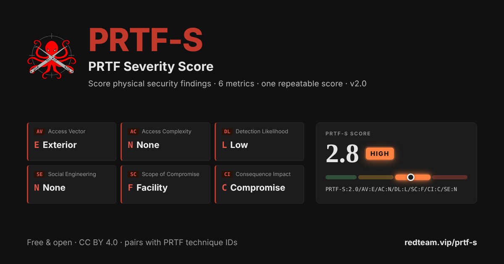

# PRTF-S: PRTF Severity Score

<p align="center"></p>

PRTF-S is a free, open scoring system for **physical security findings**. Pick one value for each of six metrics and you get a repeatable score from 1.0 to 4.0, a severity level, and a short vector string you can paste into a report.

It pairs with the [Physical Red Team Framework (PRTF)](https://github.com/DavidProbinsky/prtf): the PRTF technique ID says what was done, the PRTF-S score says how bad it is.

```
PRTF-6.06 Tailgating & Piggybacking · PRTF-S 2.8 HIGH
PRTF-S:2.0/AV:E/AC:N/DL:L/SC:F/CI:C/SE:N
```

- **Calculator:** [redteam.vip/prtf-s](https://redteam.vip/prtf-s/)
- **Data:** [`data/prtf-s.json`](data/prtf-s.json) (metrics, formula, bands and examples)
- **Reference implementation:** [`scripts/prtf-s.js`](scripts/prtf-s.js)
- **License:** [CC BY 4.0](LICENSE). Free to use, share and adapt, including commercially, with credit.

Formerly published as PS-CVSS (v1.1, March 2026). See the [CHANGELOG](CHANGELOG.md).

## The six metrics

Four metrics describe how easy the finding is to exploit. Two describe how bad the outcome is. Every value is a whole number from 1 to 4.

| Metric | Question | 1 | 2 | 3 | 4 |
|---|---|---|---|---|---|
| **AV** Access Vector | Where does the attacker start? | P Perimeter | E Exterior | I Interior | U Unrestricted |
| **AC** Access Complexity | How much effort does exploitation take? | H High | M Medium | L Low | N None |
| **DL** Detection Likelihood | How likely is the attacker to be detected? | H High | M Medium | L Low | N None |
| **SE** Social Engineering Required | Was social engineering needed? | C Complex | A Active | P Passive | N None |
| **SC** Scope of Compromise | What access is gained? | L Limited | Z Zone | F Facility | M Multi-site |
| **CI** Consequence Impact | What is the worst realistic outcome? | I Info | D Disruption | C Compromise | X Catastrophic |

Full definitions for every value are in the calculator's guide and in `data/prtf-s.json`.

## The formula

```
E = (AV + AC + DL + SE) / 4                      exploitability, 1 to 4
I = (2 x the higher of SC and CI + the lower) / 3   impact, 1 to 4
Score = 1 + (I - 1) x (E + 2) / 6               rounded to one decimal
If CI is X (physical harm possible), the score is at least 2.5
```

Impact sets the ceiling. An easy finding with a minor outcome stays low, and how easy it is only decides how close the score gets to that ceiling. Two assessors who agree on the metrics always get the same score.

| Score | Severity |
|---|---|
| 1.0 to 1.6 | LOW |
| 1.7 to 2.4 | MEDIUM |
| 2.5 to 3.2 | HIGH |
| 3.3 to 4.0 | CRITICAL |

## Vector string

```
PRTF-S:2.0/AV:E/AC:N/DL:L/SC:F/CI:C/SE:N = 2.8 (HIGH)
```

Link straight to a scored finding: `https://redteam.vip/prtf-s/#AV:E/AC:N/DL:L/SC:F/CI:C/SE:N`

Vectors written in the older PS-CVSS format (`AV:E / AC:N / ...`) still load in the calculator and are rescored with v2.0.

## Scored examples

| Finding | Vector | Score |
|---|---|---|
| Server room unsecured during after-hours access window | `AV:I/AC:N/DL:N/SC:M/CI:X/SE:N` | 3.9 CRITICAL |
| Fire exit door propped open, no alarm triggered | `AV:E/AC:N/DL:L/SC:F/CI:C/SE:N` | 2.8 HIGH |
| Wiegand readers send credentials in cleartext | `AV:E/AC:M/DL:N/SC:F/CI:C/SE:N` | 2.7 HIGH |
| IT vendor pretext, access to wiring closet | `AV:E/AC:M/DL:M/SC:Z/CI:D/SE:A` | 1.7 MEDIUM |
| Sensitive documents on unattended workstations | `AV:I/AC:L/DL:M/SC:L/CI:I/SE:C` | 1.0 LOW |
| Visitor log left open at unattended reception | `AV:E/AC:L/DL:H/SC:L/CI:I/SE:C` | 1.0 LOW |

## Use it in your own tools

```js
const { score } = require('./scripts/prtf-s.js');
score('AV:E/AC:N/DL:L/SC:F/CI:C/SE:N');
// { score: 2.8, severity: 'HIGH', exploitability: 3.25, impact: 3, vector: 'PRTF-S:2.0/...' }
```

From the command line:

```bash
node scripts/prtf-s.js "AV:E/AC:N/DL:L/SC:F/CI:C/SE:N"
```

## Scoring guidance

- Score what you observed, not the worst thing you can imagine.
- Score each finding on its own. If two findings chain together, score the chain as its own finding.
- When more than one assessor scores a finding, review any metric where values differ by more than one point.
- PRTF-S measures severity, not total business risk. Scores are advisory and support professional judgment.

## Cite

> Probinsky, D. (2026). PRTF Severity Score (PRTF-S), version 2.0. Red Team LLC. https://redteam.vip/prtf-s/

GitHub's "Cite this repository" button uses [`CITATION.cff`](CITATION.cff).

## License and trademarks

PRTF-S is licensed under [CC BY 4.0](LICENSE). Created by David Probinsky, [Red Team LLC](https://redteam.vip/).

PRTF-S is not affiliated with or endorsed by FIRST and does not use the CVSS formula. CVSS is a registered trademark of FIRST.Org, Inc. For authorized physical security assessments only.
